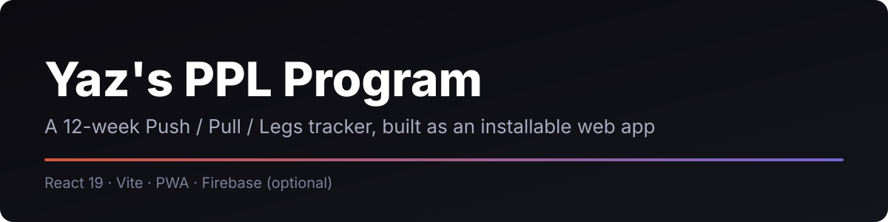

<div align="center">



<br>

A 12-week **Push / Pull / Legs** training app I built for myself, because I wanted a plan built around my own gym and goals, not a generic YouTube program. It is designed around one gym, one goal and one person, and I use it in real workouts.


</div>

## What it does

| Feature | How it works |
|---|---|
| 12-week plan | Three training days (Push, Pull, Legs) with intensity that ramps by week, mapped to the equipment of one specific gym. |
| Set logging | Log weight and reps per set. The log is saved on the device and survives a reload. |
| Rest timers | Tap a set as done and a rest timer starts automatically. |
| Unit helpers | Kilogram to pound conversion and a plate calculator for loading the bar. |
| Progress charts | Per-exercise history charts (Recharts) so you can see the 12-week roadmap move. |
| Calendar export | One tap exports the whole plan to an `.ics` file for any calendar app. |
| Installable | PWA with offline support, so it opens instantly even on bad gym Wi-Fi. |
| Optional cloud sync | Sign in with Google and the log syncs to Firestore. Without it the app works fully on `localStorage`. |

## Run it

```bash
npm install
npm run dev
```

| Script | What it does |
|---|---|
| `npm run dev` | Local development |
| `npm run build` | Production build (also generates the service worker) |
| `npm run lint` | ESLint |
| `npm run preview` | Serve the production build locally |

### Optional: cloud sync

1. Create a Firebase project with Google sign-in and Firestore.
2. Copy `.env.example` to `.env.local` and fill in your own Firebase web app values.
3. Deploy `firestore.rules`. They let a signed-in person read and write only their own `users/{uid}` document.

Leave the values empty and the sign-in button is hidden.

### Exercise demo videos

The original app plays short demo clips next to each exercise. They are other people's videos, so they are **not in this repo**. Put your own clips in `public/videos/<id>.mp4`, or set `VITE_VIDEO_BASE` to a folder or CDN. If a clip is missing the player hides itself and nothing breaks.

## Design notes

- **One person, one plan.** The program is deliberately specific. That is what made it usable.
- **Local first.** Everything works offline from `localStorage`. The cloud is an add-on, never a requirement.
- **No secrets in the repo.** Firebase settings come from environment variables.

## Author

Built by [Yassine Emhamed](https://www.yassine-emhamed.net), IT and Network Engineer.
